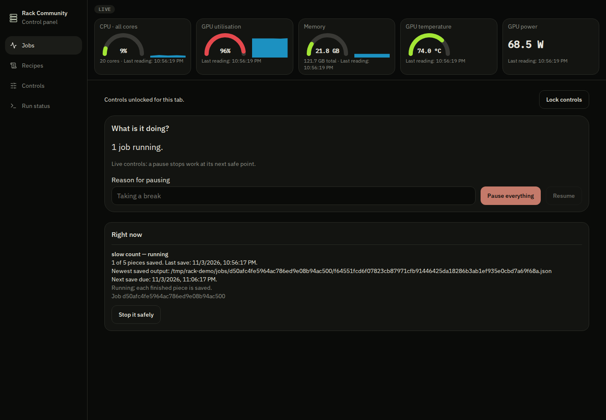
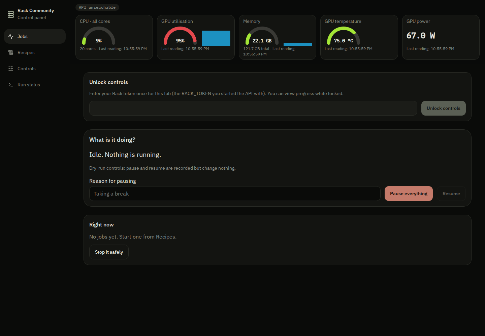
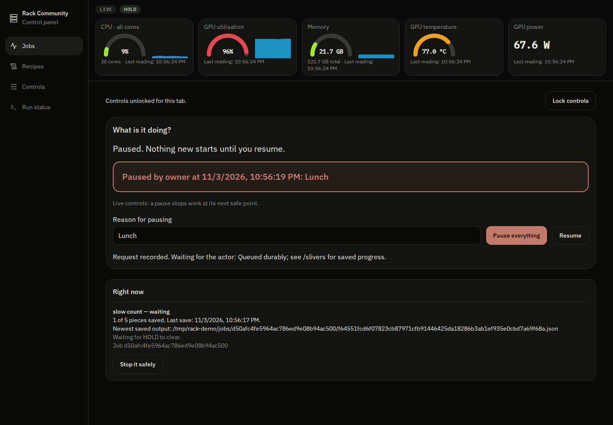
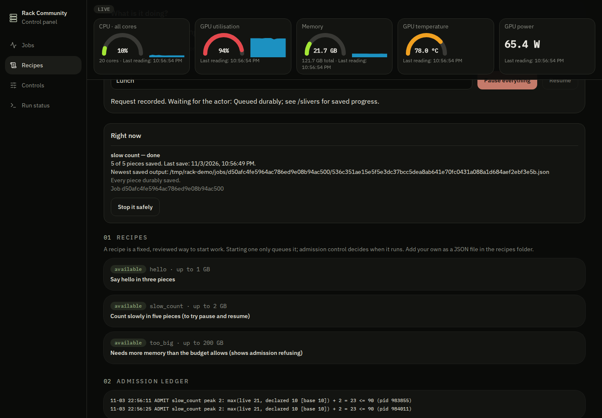
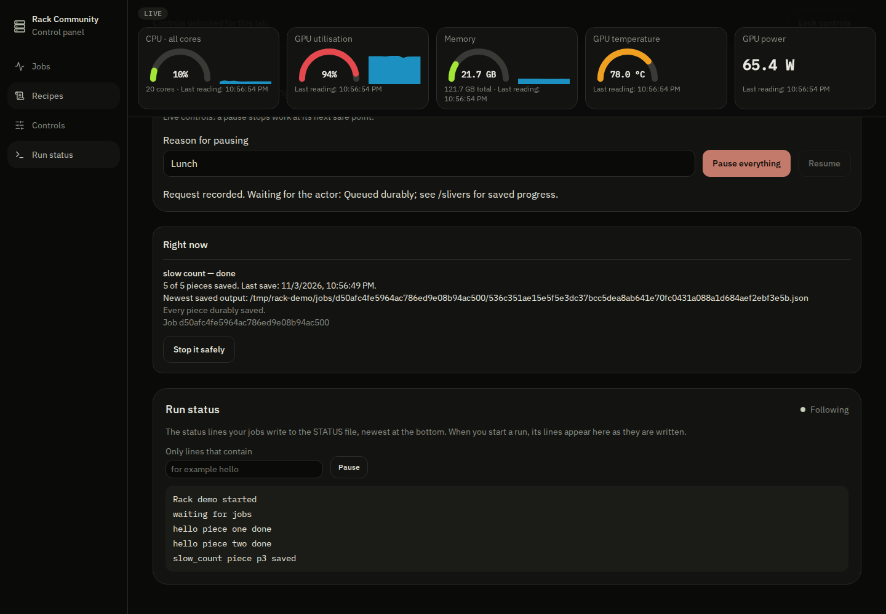
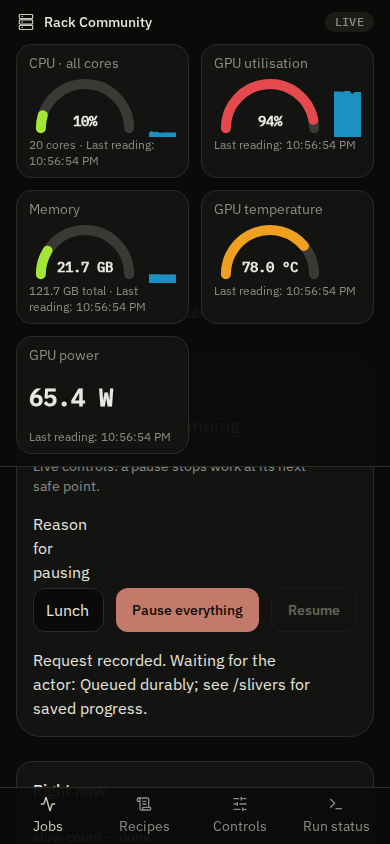

# Rack Community

**A self-hosted home AI lab for one box: live gauges, a job runner that refuses to overload the machine, recipe templates for training and testing, memory you approve, and a team room any AI can join.**

If this is useful to you, a star helps other people find it.



| | |
| --- | --- |
|  |  |
| Controls stay locked until you paste your token. | Pause says who paused and why. Saved pieces are kept. |
|  |  |
| Recipes, and what memory each one is allowed to use. | Run status follows your own log lines as they are written. |
|  | |
| Works at phone width. | |

## Install

Linux, Node 24, Python 3. Everything listens on `127.0.0.1`.

```bash
# clone or download this repository, then from its top folder:
./start.sh
# open http://127.0.0.1:8080 and paste the token that start.sh prints the path of
```

Then **Controls**, switch to **LIVE**, pick `slow_count`, **Check it fits**, **Start**, type `START`. Press **Pause everything** half way, then **Resume**: the saved pieces are kept and the job finishes.

## What you get

| Folder | What it is |
| --- | --- |
| `engine/` | The core, in Python. A durable job queue; an actor that runs one admitted job at a time with a hard deadline per piece; `admit.sh` memory admission control; recipes; host gauges (CPU, memory, and GPU if `nvidia-smi` exists; a reading that cannot be taken shows `unavailable`, never a made-up zero); a small HTTP API. |
| `panel/` | The control panel (React, TanStack Start): gauges, "what is it doing", jobs with saved progress, recipes, controls, run status. |
| `memory/` | **Somnus.** A control plane for AI-agent memory. It runs a *dream* pass over a memory folder and reports what it proposed, what it applied and what waits for a person. Judgment-class changes wait for a human; you can diff a snapshot against live and roll back. It calls no model provider. |
| `room/` | **TalkBack.** A team room for people and AI agents: channels, threads, reactions, mentions, a *wire* so an AI agent joins as a desk with its own key, huddles, and an Electron shell that hosts the room on your LAN. |

Each folder is its own project with its own `package.json` or `requirements.txt`.

## Bring your own AI

Rack Community ships no model and no keys. It is the place your models run and report.

- **Local:** point a recipe at [Ollama](https://ollama.com). `engine/samples/ask_model_pieces.py` asks a list of questions, one saved piece per answer, against `http://127.0.0.1:11434/v1` by default.
- **Hosted:** the same script works with any OpenAI-compatible endpoint. Set `RACK_LLM_URL`, `RACK_LLM_MODEL` and, if the service needs one, `RACK_LLM_KEY` (sent as a Bearer token and never written to the saved pieces).
- **In the room:** any AI agent that can make an HTTP call can join TalkBack as a desk with its own key (`room/tools/talkback-wire.mjs` is a small client).

To use the sample, copy `engine/samples/ask_model.recipe.json` into your Rack folder's `recipes/` and add `ask_model 8` to its `peaks.conf`.

## How it works

**Admission control.** `admit.sh` admits a job only if `max(live memory in use, declared total) + the job's peak <= LIMIT`. The declared total is a base figure plus the declared peaks of admitted jobs that are still alive, so two jobs that have not yet touched memory cannot both be admitted into the same gap. A refused job exits `75` and says why. Peaks live in `peaks.conf`; `ADMIT_LIMIT` (default 90) and `ADMIT_BASE` (default 10) are in GB.

**Durable pieces.** A job is split into named pieces. Each piece result is written atomically and in order, so a crash, a restart or a pause resumes at the first piece that was not saved. A supervisor outside the worker enforces a wall-clock limit per piece, including a worker stuck in a native call.

**Dry-run first.** The Rack starts in dry-run: every request is validated and recorded and nothing changes. Switching to LIVE is one explicit action. Pause writes a single `HOLD` marker; work queued before the pause waits, new starts are refused while it exists.

**Recipes, not commands.** A start names a recipe from `recipes/*.json`. No endpoint accepts a command line, a path or a shell string.

```json
{"action": "nightly_index", "label": "Rebuild the search index", "script": "samples/hello_pieces.py",
 "args": [], "admission": "nightly_index", "peak_gb": 4}
```

Add the recipe file, add `nightly_index 4` to `peaks.conf`, and write the script with `from rack_jobs import from_environment`. See `engine/samples/` for complete examples. More detail in [`docs/ARCHITECTURE.md`](docs/ARCHITECTURE.md).

## Security

- The API needs the `X-Rack-Token` header for every write and for the two reads that show your log lines. With no `RACK_TOKEN` set, nothing unlocks.
- Bind everything to `127.0.0.1`, or put it behind your own access boundary. Do not expose it to the internet as it is.
- **Somnus and TalkBack have no sign-in.** They run as one local owner. Their server functions refuse requests that a browser reports as started by another site, but they are not a multi-user service.
- The panel keeps the token in `sessionStorage` for one tab and never puts it in a URL, a body or a log. Workers never receive it.
- Admission, pause and the recipe list are safety rails, not a sandbox: a recipe script runs as the user who started the actor.

## Somnus and TalkBack on their own

Use a different port from the panel:

```bash
cd memory && npm install && npm run dev -- --port 8081   # http://127.0.0.1:8081
cd room   && npm install && npm run dev -- --port 8082   # http://127.0.0.1:8082
```

Somnus keeps its state in an embedded database, in memory by default; set `PGLITE_DATA_DIR` to keep it. TalkBack's desktop shell is described in `room/desktop/README-DESKTOP.md`.

## Tests

Run the narrowest check that covers what you changed.

```bash
cd engine && python3 -m pytest -q tests                                       # 38 tests
cd panel  && npx tsc --noEmit && npm test                                     # 19 tests
cd memory && npx tsc --noEmit && npm test                                     # 39 tests
cd room   && npx tsc --noEmit && npm test                                     # 61 tests
```

Those are unit and small integration tests. There is no browser end-to-end suite in this repository, and the full test suites of the original apps were not carried over (see "What is not here").

## What is not here

- No company-specific assistant, recipes, prompts, data or customer material. This is the general-purpose part only.
- The engine was rewritten from the mechanisms of a private lab (the admission rule, ordered atomic pieces, external deadlines, a pause that holds starts, dry-run first). It is not a cleaned copy of that code.
- The web apps in `panel/`, `memory/` and `room/` started from an app template whose licence we could not establish. Its sign-in layer, install-page scripts and the tests that only exercised them were removed before this release, and the apps now run as one local owner. Some template-era source files remain in the apps; see `NOTICE`.
- Somnus's Backup page and checkpoint tool were removed because they copied files specific to one machine. The TalkBack relay has no authentication of its own (see `room/relay/README.md`).
- Version 1.0.0 is a first public release. Expect rough edges.

## Contributing

Issues and pull requests are welcome. Keep changes small, keep the safety rails (admission, dry-run, token-checked writes) intact, and say which tests you ran.

## License

MIT. See `LICENSE` and `NOTICE`. Copyright (c) Rack Community contributors.
