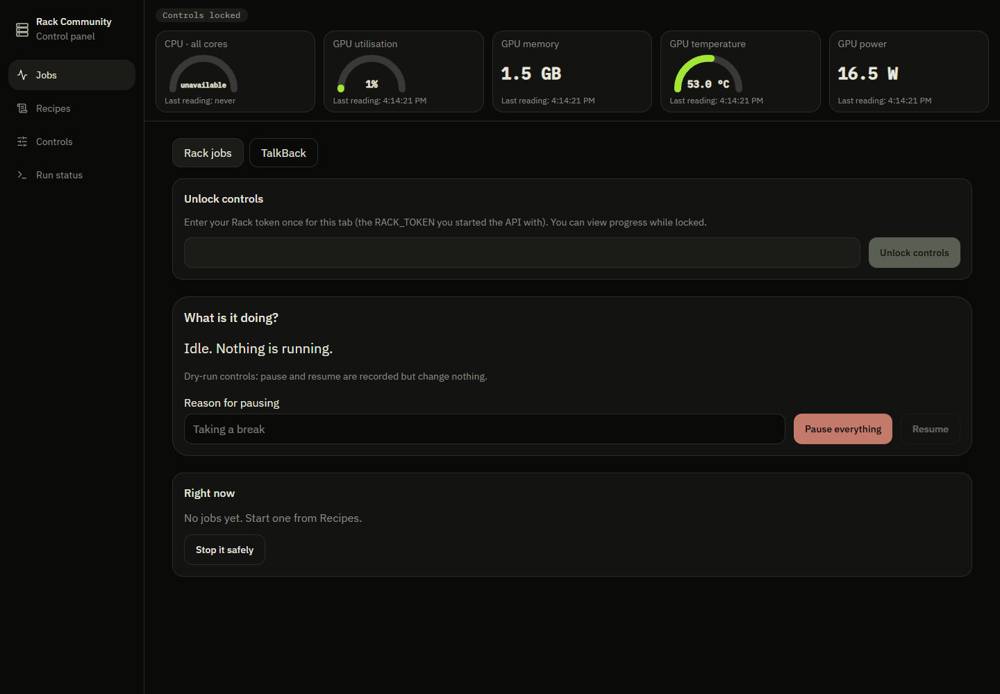
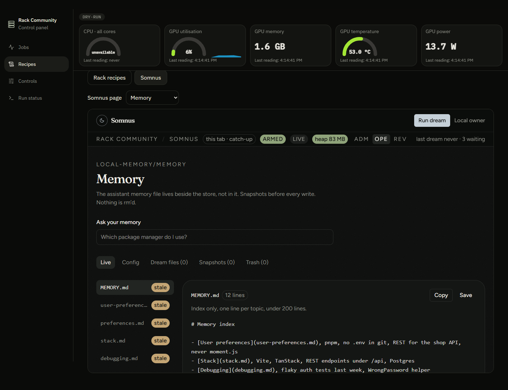
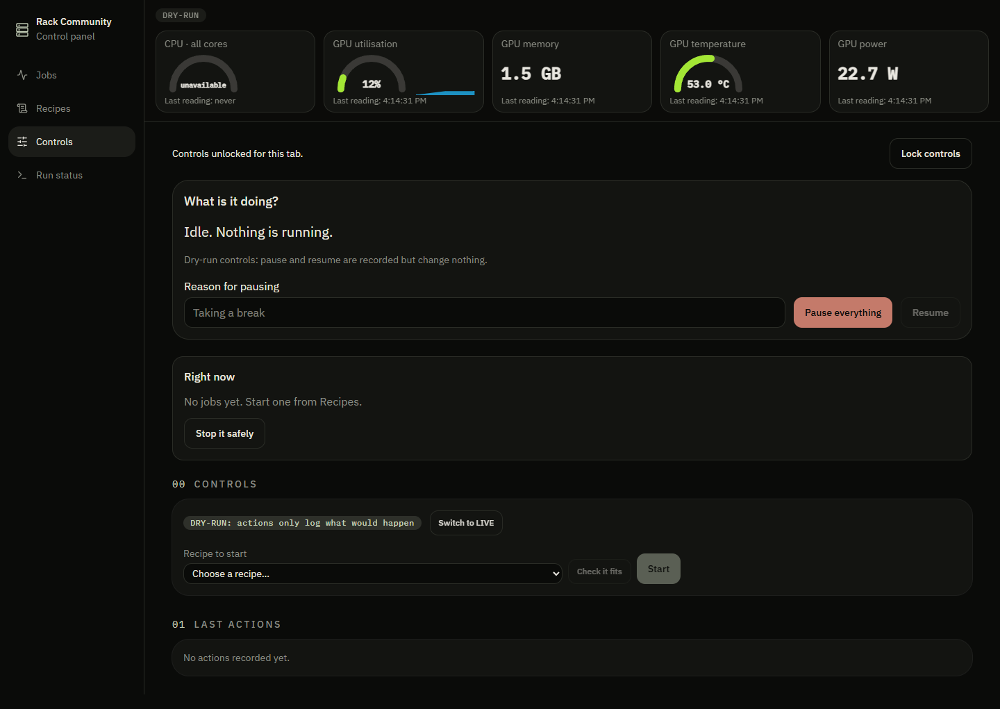
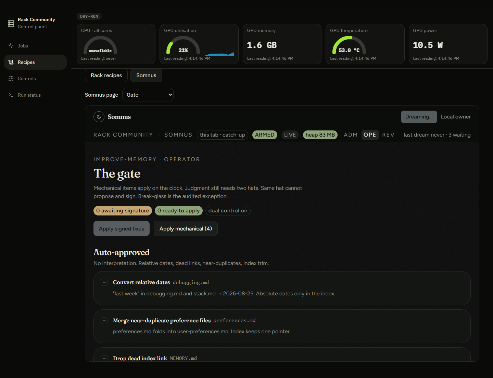
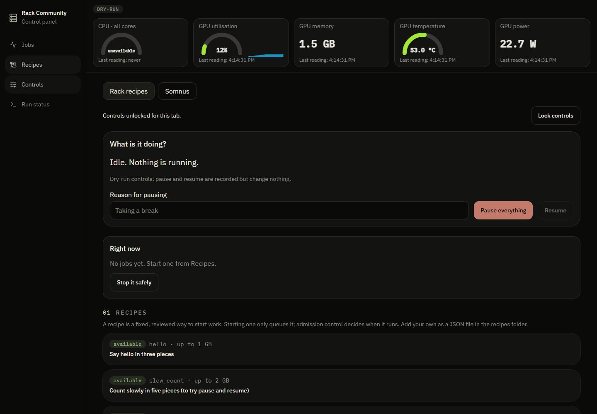
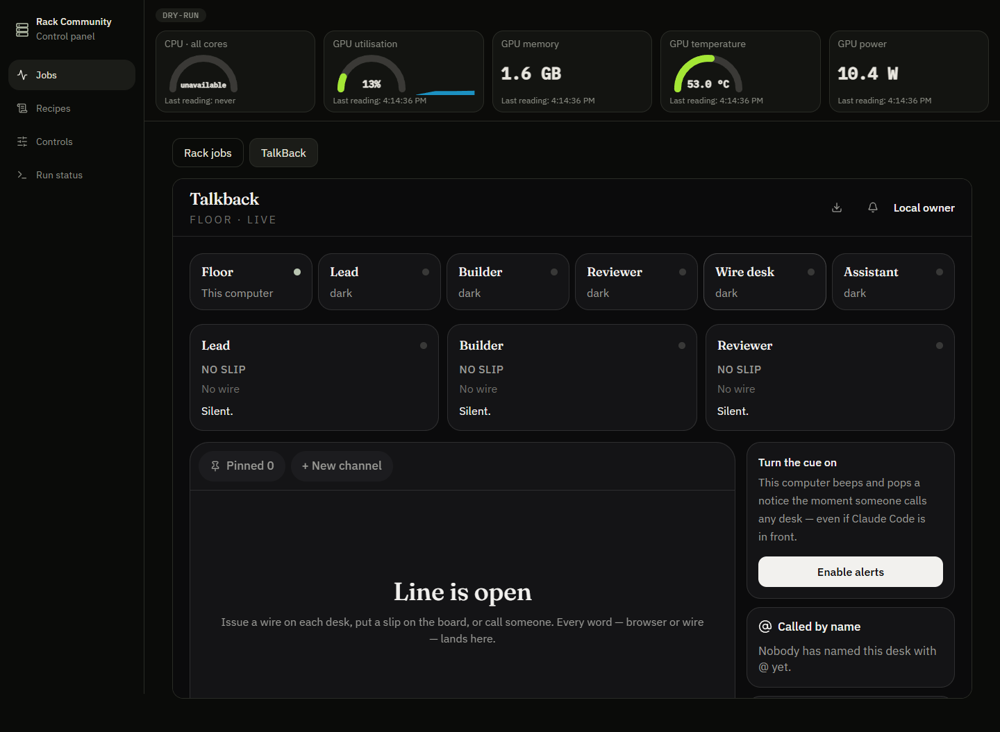
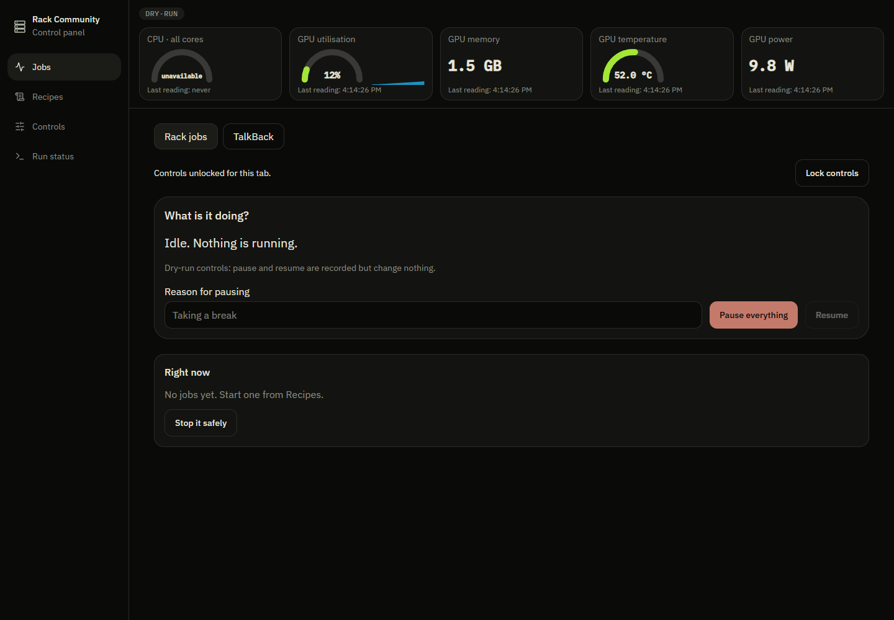
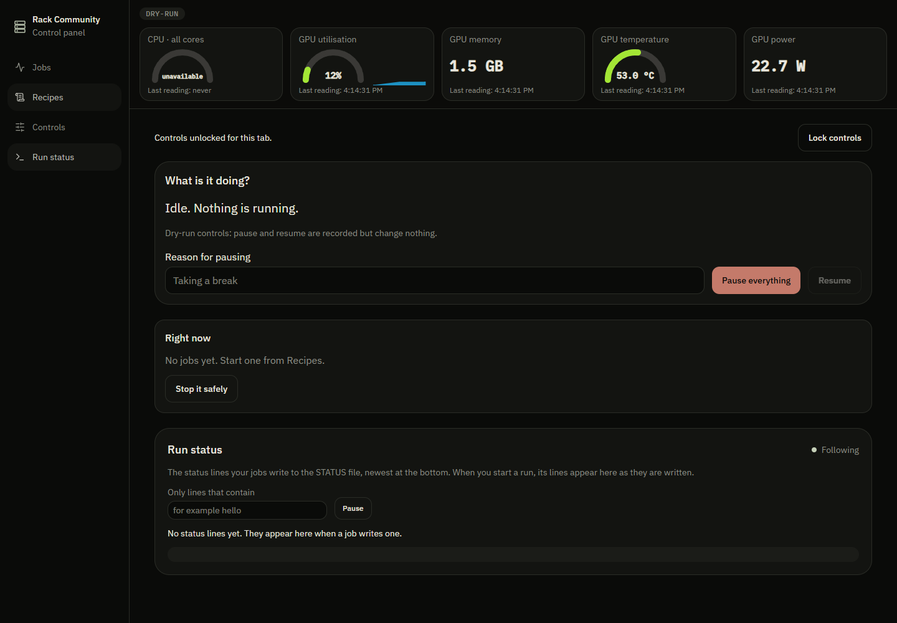

# Rack Community

**A self-hosted home AI lab for one box: live gauges, a job runner that refuses to overload the machine, recipe templates for training and testing, memory you approve, and a team room any AI can join.**

If this is useful to you, a star helps other people find it.


| Rack controls | Integrated memory |
| --- | --- |
|  |  |
|  |  |
|  |  |
|  |  |

## Quick start

Linux (or WSL2), Node 24, Python 3 with venv, Bash and flock. Everything listens on `127.0.0.1`.

```bash
# clone or download this repository, then from its top folder:
./rack install && ./rack up
# open the panel URL printed after all services are ready
```

The installer installs the engine, panel, Somnus and TalkBack together. One owner process starts the API, actor and all three web services, waits for readiness, prints their local URLs, and stops the whole group on Ctrl+C or a child failure. A second owner is refused. `start.sh` remains a compatibility wrapper for this same path. `node rack.mjs install` and `node rack.mjs up` are equivalent if your download loses executable permissions.

Data persists under `.data/rack` by default; set `RACK_DIR` to choose another directory. Engine recipes are copied only on first use; existing recipes and databases are preserved. Somnus and TalkBack each keep a separate PGLite database under that directory, with the same `local-owner` identity. The install does not start the optional LAN relay or Electron wrapper.

The four views remain Jobs, Recipes, Controls and Run status. **Jobs > TalkBack** opens the team room; **Recipes > Somnus** opens memory tools in the same panel. Somnus page selection is in that view, with its standalone navigation hidden. **Wire desk** replaces the old label. `/grok` and `?desk=grok` redirect to `/?desk=wire`; the stored `grok` wire ID remains compatible with existing clients and keys.

Default ports are panel 8080, Somnus 8081, TalkBack 8082 and engine 8797. Override them with `RACK_PANEL_PORT`, `RACK_MEMORY_PORT`, `RACK_ROOM_PORT` and `RACK_API_PORT`. The launcher prints the token file path; paste its contents into Unlock controls.

Then **Controls**, switch to **LIVE**, pick `slow_count`, **Check it fits**, **Start**, type `START`. Press **Pause everything** half way, then **Resume**: the saved pieces are kept and the job finishes.

## What you get

| Folder | What it is |
| --- | --- |
| `engine/` | The core, in Python. A durable job queue; an actor that runs one admitted job at a time with a hard deadline per piece; `admit.sh` memory admission control; recipes; host gauges (CPU, memory, and GPU if `nvidia-smi` exists; a reading that cannot be taken shows `unavailable`, never a made-up zero); a small HTTP API. |
| `panel/` | The control panel (React, TanStack Start): gauges, "what is it doing", jobs with saved progress, recipes, controls, run status. |
| `memory/` | **Somnus.** A control plane for AI-agent memory. It runs a *dream* pass over a memory folder and reports what it proposed, what it applied and what waits for a person. Judgment-class changes wait for a human; you can diff a snapshot against live and roll back. It calls no model provider. |
| `room/` | **TalkBack.** A team room for people and AI agents: channels, threads, reactions, mentions, a *wire* so an AI agent joins as a desk with its own key, huddles, and an Electron shell that hosts the room on your LAN. |

The folders are components of one installation, with their own dependency manifests.

## Bring your own AI

Rack Community ships no model and no keys. It is the place your models run and report.

- **Local:** point a recipe at [Ollama](https://ollama.com). `engine/samples/ask_model_pieces.py` asks a list of questions, one saved piece per answer, against `http://127.0.0.1:11434/v1` by default.
- **Hosted:** the same script works with any OpenAI-compatible endpoint. Set `RACK_LLM_URL`, `RACK_LLM_MODEL` and, if the service needs one, `RACK_LLM_KEY` (sent as a Bearer token and never written to the saved pieces).
- **In the room:** any AI agent that can make an HTTP call can join TalkBack as a desk with its own key (`room/tools/talkback-wire.mjs` is a small client).

To use the sample, copy `engine/samples/ask_model.recipe.json` into your Rack folder's `recipes/` and add `ask_model 8` to its `peaks.conf`.

## How it works

**Admission control.** `admit.sh` admits a job only if `max(live memory in use, declared total) + the job's peak <= LIMIT`. The declared total is a base figure plus the declared peaks of admitted jobs that are still alive, so two jobs that have not yet touched memory cannot both be admitted into the same gap. A refused job exits `75` and says why. Peaks live in `peaks.conf`; `ADMIT_LIMIT` (default 90) and `ADMIT_BASE` (default 10) are in GB.

**Durable pieces.** A job is split into named pieces. Each piece result is written atomically and in order, so a crash, a restart or a pause resumes at the first piece that was not saved. A supervisor outside the worker enforces a wall-clock limit per piece, including a worker stuck in a native call.

**Dry-run first.** The Rack starts in dry-run: every request is validated and recorded and nothing changes. Switching to LIVE is one explicit action. Pause writes a single `HOLD` marker; work queued before the pause waits, new starts are refused while it exists.

**Recipes, not commands.** A start names a recipe from `recipes/*.json`. No endpoint accepts a command line, a path or a shell string.

```json
{"action": "nightly_index", "label": "Rebuild the search index", "script": "samples/hello_pieces.py",
 "args": [], "admission": "nightly_index", "peak_gb": 4}
```

Add the recipe file, add `nightly_index 4` to `peaks.conf`, and write the script with `from rack_jobs import from_environment`. See `engine/samples/` for complete examples. More detail in [`docs/ARCHITECTURE.md`](docs/ARCHITECTURE.md).

## Security

- The API needs the `X-Rack-Token` header for every write and for the two reads that show your log lines. With no `RACK_TOKEN` set, nothing unlocks.
- Bind everything to `127.0.0.1`, or put it behind your own access boundary. Do not expose it to the internet as it is.
- **Owner password is optional and off by default.** All components run as one local owner. Their server functions refuse requests that a browser reports as started by another site, but they are not a multi-user service.
- The panel keeps the token in `sessionStorage` for one tab and never puts it in a URL, a body or a log. Workers never receive it.
- Admission, pause and the recipe list are safety rails, not a sandbox: a recipe script runs as the user who started the actor.

## Owner password

Set one variable, **RACK_OWNER_PASSWORD**, before running `./rack up`. For example, in Bash use `read -rsp 'Owner password: ' RACK_OWNER_PASSWORD; export RACK_OWNER_PASSWORD`, then start Rack. Do not put the value in source or command history. Unset it to disable the gate.

The panel, Somnus, TalkBack and engine reject unauthenticated requests when enabled. Sign in once in the panel: an HttpOnly, SameSite=Strict cookie shares the local owner session across the loopback ports for 12 hours. Changing the password invalidates existing sessions. The separate Rack controls token is still required for engine writes and log reads. Workers receive neither secret. Cookies use local HTTP; this is a loopback installation, not an internet authentication service. The optional standalone Electron packaging is a separate advanced mode, not the Rack owner launcher; keep it behind your own access boundary.

## Tests and screenshots

From the repository root, after installation:

```bash
npm test
npm run typecheck
npm run scan
# With Rack running, RACK_TOKEN set from its token file, and Playwright Chromium installed:
npm run screenshots -- /path/to/screenshots
```

The root commands run the repository's existing engine, panel, memory and room suites and each app's own typecheck. The desktop wire integration rebuilds the current source and tests a real packaged server. No tests were deleted. Screenshots exercise the panel and both embedded apps at 1440px. Set RACK_BROWSER_CHANNEL=chrome to use an installed Chrome, and RACK_SCREENSHOT_URL for a non-default panel port. Screenshot output contains no token or password.

### Known platform limitations

On native Windows, 14 engine admission/actor tests are explicitly skipped: they require Linux fcntl, flock, /proc and POSIX process groups. One TalkBack holder-detection test is skipped outside Linux because it reads process environments from /proc. The test names and reasons remain visible. Run on Linux or WSL2 to exercise those checks and use the complete launcher; native Windows cannot run the engine actor. This repository cannot bundle a Linux kernel. The remaining tests, including desktop wire authentication, run on Windows. These skips are not evidence that the Linux launch has been verified here.

The six template failures mentioned in the incoming order were not reproduced as six failures in this base revision. Current failures were corrected against current behavior: cross-platform npm invocation, canonical LF hashing of demo data, and explicit platform dependency skips. The desktop integration passed against a fresh build; its runner now always rebuilds so it cannot silently test stale code.

The export's scan script and NOTICE.md strip list were absent from this base. `tools/scan.mjs` supplies a reproducible public-tree audit for credentials, private URLs, machine paths and private workspace markers. Synthetic SSRF refusal fixtures have narrowly listed exceptions. Review any new customer content manually; a pattern scanner cannot identify every person's name.

## What is not here

- No company-specific assistant, recipes, prompts, data or customer material. This is the general-purpose part only.
- The engine was rewritten from the mechanisms of a private lab (the admission rule, ordered atomic pieces, external deadlines, a pause that holds starts, dry-run first). It is not a cleaned copy of that code.
- The web apps in `panel/`, `memory/` and `room/` started from an app template whose licence we could not establish. Its sign-in layer, install-page scripts and the tests that only exercised them were removed before this release, and the apps now run as one local owner. Some template-era source files remain in the apps; see `NOTICE`.
- Somnus's Backup page and checkpoint tool were removed because they copied files specific to one machine. The TalkBack relay has no authentication of its own (see `room/relay/README.md`).
- Version 2.0.0 brings the components under one local installation and panel.

## Contributing

Issues and pull requests are welcome. Keep changes small, keep the safety rails (admission, dry-run, token-checked writes) intact, and say which tests you ran.

## License

MIT. See `LICENSE` and `NOTICE`. Copyright (c) Rack Community contributors.

## Somnus demo data

Advanced component reference; paths and commands below are relative to `memory/demo`. The normal install remains the Quick start above.


Everything in this folder is synthetic: one made-up week for a made-up business
(Blue Water Pools and Outdoor Living). Every email is on the reserved `.example`
domain. Every record id, and the demo role, starts with `sdemo-`.

| File | What it is |
| --- | --- |
| `somnus-demo-seed.json` | The data. Schema `somnus-demo-seed/1`. |
| `somnus-demo-seed.manifest.json` | Schema version, sha256 of the data file, row counts per table, the demo role, the id prefix. |

`src/lib/dream/demo-seed.ts` is the only loader. The seed script, the in-app
"Load the sample week" button (Tour page) and the tests all read this one file.
`npm run test:somnus` fails if the data changes without a new manifest, or if a
record is missing the `sdemo-` prefix, or if any email is not `.example`.

### The rules

- **Nothing seeds automatically.** No code path calls the seeder on boot or on
  deploy. Seeding happens only when a person runs one of the commands below, or
  presses "Load the sample week" in their own account.
- **Production is guarded.** The script refuses when `VERCEL_ENV` or `NODE_ENV`
  is `production`, or when `DATABASE_URL` is set, unless `SOMNUS_DEMO_TARGET=demo`
  says this target IS the demo platform. A host listed in
  `SOMNUS_PROD_DB_HOSTS` (comma separated) is refused even then.
- **The in-app button is off on production** unless that deployment sets
  `SOMNUS_DEMO_DOOR=on` (set it only on the demo platform).
- **Cleanup touches only the sample.** Every delete requires the demo role (or
  the signed-in account, for the button) AND an id listed in the data file.
  Other accounts, and any row with another id, are never touched. No table or
  database is ever dropped.
- **Idempotent.** `seed` clears its own rows first, so running it twice gives
  the same 18 rows, not 36.
- **The demo role never becomes the owner.** Somnus lets its first signed-in
  account claim the control plane; `sdemo-` rows are ignored for that claim, so
  seeding a fresh database cannot lock real people out.

### Commands

Mode is `seed`, `clean`, `reset` (clean then seed) or `check` (count only, writes nothing).

Local, kept in a folder the dev server can then serve:

    PGLITE_DATA_DIR=.demo-db npm run demo:reset
    PGLITE_DATA_DIR=.demo-db npm run demo:check

Demo platform database (never the production one):

    SOMNUS_DEMO_TARGET=demo DATABASE_URL=<demo database url> npm run demo:check
    SOMNUS_DEMO_TARGET=demo DATABASE_URL=<demo database url> npm run demo:reset
    SOMNUS_DEMO_TARGET=demo DATABASE_URL=<demo database url> npm run demo:clean

Each run prints which database it is writing to before it writes, then the
counts: `removed`, `seeded`, `now present`. Expected after `reset`:
`{"jobs":5,"audit":6,"deliveries":4,"hooks":2,"daemon":1}`. After `clean`: all zero.

### Walking the demo as a prospect

1. Start the app on the demo database, with the prospect's (or a synthetic)
   account allowed: `SOMNUS_ALLOWED_USERS=<email>`. On the demo platform also set
   `SOMNUS_DEMO_DOOR=on`.
2. Sign in, open **Tour**, press **Load the sample week**. The sample sits next to
   anything the account already has; it never replaces a record.
3. Follow the ten tour stops. **Backup** is the five-button restore walkthrough.
4. When finished, press **Remove the sample week** on the Tour page. Only the
   sample goes.

### Screenshots

`node scripts/capture-screenshots.mjs` (app running, synthetic accounts
`sdemo-qa-{phone,tablet,desktop}@example.test` allowed) writes
`store/screenshots/{phone,tablet,desktop}/`. See `store/screenshots.md`.

## Somnus SDK and MCP

Advanced component reference; paths and commands below are relative to `memory/sdk/somnus-sdk`. The normal install remains the Quick start above.


Read, search and score a Somnus memory folder from your own code. No account, no network, no dependencies. Read-only: changes to memory go through the Somnus dream, which shows a diff and waits for a yes.

```ts
import { SomnusMemory } from "@rack-community/somnus-sdk";

const memory = SomnusMemory.fromDirectory("/path/to/memory");   // every .md file in the folder
memory.list();                                                   // [{ name, lines }]
memory.read("stack.md");                                         // the file text, or null
memory.search("which package manager do I use?");                // [{ file, line, text, score }]
memory.benchmark([{ q: "what database", expect: "stack.md" }]);  // { recallAt1, recallAt3, recallAt5, mrr, misses }
```

Search is plain-English and runs on your machine: it ranks lines (BM25) with a small list of everyday synonyms, so "why did the login tests break" finds the line about the failed auth tests.

`benchmark` scores search on your own questions: for each, did the right file come back first, in the top 3, in the top 5, and the mean reciprocal rank. It is the same method long-memory benchmarks report; it is not the public LoCoMo or LongMemEval data.

### MCP server (stdio, read-only)

```
SOMNUS_MEMORY_DIR=/path/to/memory node --experimental-strip-types src/bin.ts
```

Tools: `somnus_search_memory`, `somnus_list_memory`, `somnus_read_memory`. Add it to an AI tool's MCP settings as a command. There is deliberately no write tool.

### Tests

`npm test` inside this folder (Node 22.6 or newer). 6 tests: search, benchmark, folder reading, the MCP messages, and the MCP server over a real pipe.

## Optional TalkBack voice relay

Advanced component reference; paths and commands below are relative to `room/relay`. The normal install remains the Quick start above.


A small relay for huddle audio. It does two jobs in one process:

- **Signalling.** `/ws` accepts `{type:"join",company,callId,peer,name}` and then `{type:"signal",to,kind,payload}`
  (`offer`, `answer`, `ice`). An absent `to` broadcasts only inside that room. Sender ids come from the socket,
  membership is memory-only and removed on disconnect, and no SDP, ICE, audio or keys are logged or stored.
- **TURN.** `GET /ice` returns STUN and UDP TURN addresses with a ten-minute username and an HMAC-SHA1 password
  (the TURN REST convention). The same process runs `node-turn` 0.0.6 and checks credentials on demand, including
  expiry, with no credential database. `GET /healthz` reports ready once both listeners are up.

### Run it

Node 22 or later is required. There is no native build.

```
cd relay
npm ci --ignore-scripts
TURN_SHARED_KEY=<a long random value> node server.mjs
```

Settings (environment variables; keep real values out of source, shell history and logs):

| Variable | Default | Meaning |
| --- | --- | --- |
| `TURN_SHARED_KEY` | none, required | Shared key the TURN credentials are derived from. Startup is refused without it. |
| `RELAY_PORT` | 8787 | HTTP and WebSocket port. |
| `TURN_PUBLIC_HOST` | loopback | Public IPv4 address or DNS-only hostname that callers can reach. |
| `TURN_PORT` | 3478 | TURN UDP port. |
| `TURN_REALM` | talkback | TURN realm. |
| `CF_TURN_KEY_ID`, `CF_TURN_KEY_TOKEN` | unset | Optional. With both set, `/ice` returns Cloudflare TURN credentials first and your own TURN as the fallback. |

When you build TalkBack, set `VITE_TALKBACK_RELAY_URL` to the HTTPS base URL of the relay. If it is unset, huddles use the
existing roll-call behaviour and the peer-to-peer transport.

### Security

The relay isolates rooms but does **not** authenticate company claims and does not restrict `/ice`. Put it behind your own
access boundary. A public, unprotected endpoint lets anyone who knows a room id join it, and lets anyone obtain temporary
TURN credentials.

### Tests

From the repository root: `node --experimental-strip-types --test relay/relay.test.ts`. Local tests are not proof of a
two-network voice call. Real UDP reachability and two-browser audio need to be checked on your own network.

## Optional TalkBack desktop packaging

Advanced component reference; paths and commands below are relative to `room/desktop`. The normal install remains the Quick start above.


The Electron shell wraps the TalkBack web app. It starts the app's own Nitro `node-server` build as a child process
(using Electron's bundled Node, `ELECTRON_RUN_AS_NODE=1`, so no system Node is needed) and loads it in a window.

Data is a local PGLite (embedded Postgres) database under the per-user application-data folder, so the team room
survives restarts. There is no sign-in: one local owner.

### Two LAN modes, no cloud

One computer runs the room as the host, bound to that machine's own network address. Other computers on the same
network join by typing that address in. There is no internet-hosted server in this flow.

### Build the installer

```
npm install
npm run desktop:build   # NITRO_PRESET=node-server build + copy PGLite assets
npm run desktop:dist    # electron-builder -> installer in dist/
```

Run unpackaged for a quick check: `npm run desktop:dev`.

The macOS build is unsigned and not notarized. Gatekeeper will refuse to open it until you add your own Apple Developer ID
certificate and notarize it; until then, right-click and choose Open.

### Data and reset

The local database lives under the user's application-data folder in a `TalkBack/db` directory. Deleting it resets the room.
`docs/PERSISTENT-DATA-DIR.md` explains `PGLITE_DATA_DIR` for keeping the data in a folder you choose.

### Changes made to the base web app (all additive)

- `vite.config.ts` reads the Nitro preset from `NITRO_PRESET` (unset by default), so a desktop `node-server` build is possible.
- `src/lib/db.ts` honours `PGLITE_DATA_DIR` for a persistent store; unset keeps an in-memory instance.
- `package.json` carries `main`, `version`, `description`, `author` and the `desktop:*` scripts.
